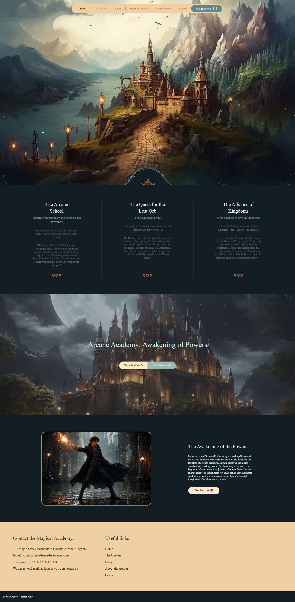
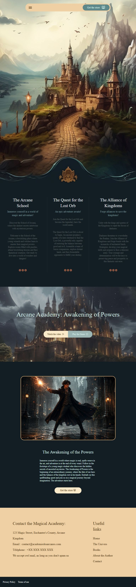
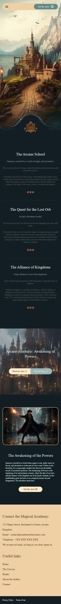
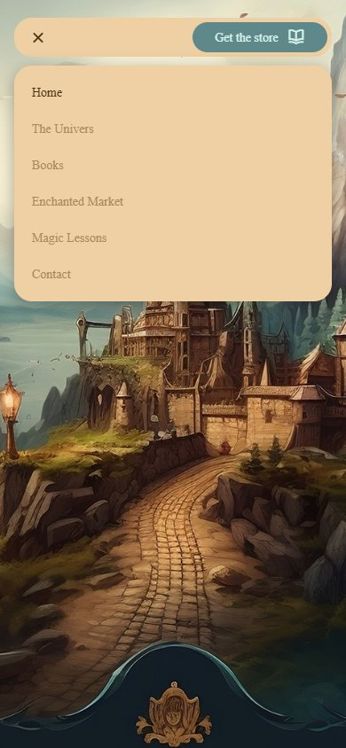
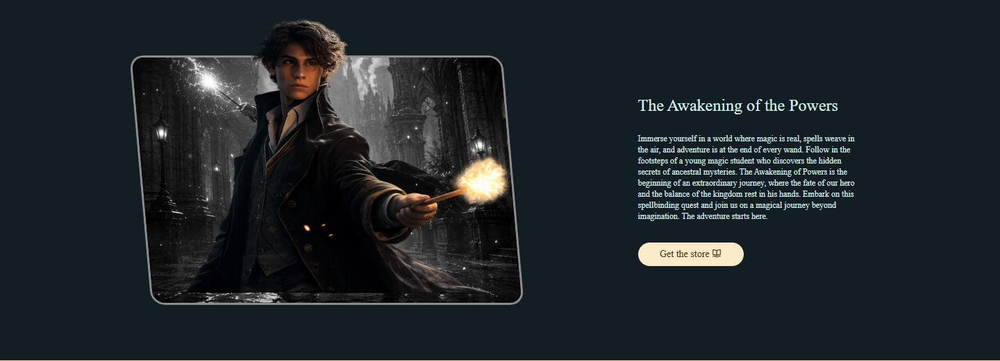
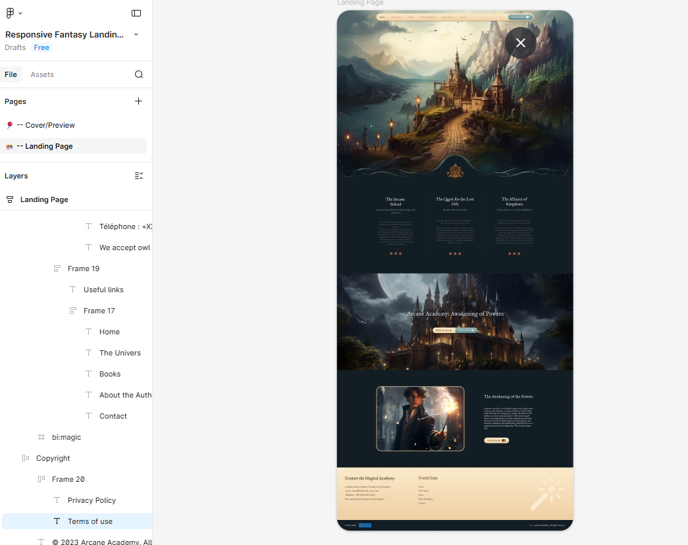

# 🏰 Enchanting Academy of Arcane Wonders — Fantasy Landing Page

A responsive, interactive fantasy landing page for the **Arcane Academy**: a school of magic, an epic quest for the Lost Orb, and an alliance of kingdoms standing against the darkness. Built with plain HTML, Tailwind CSS and a small amount of vanilla JavaScript, recreated from a community Figma design.



## 📖 About the Project

This is a front-end practice project focused on turning a Figma design into a real web page, first pixel-matching it on desktop and then making it work on every screen size. The page has five parts:

| Section | What it shows |
|---|---|
| **Hero** | A full-screen castle landscape with a floating, pill-shaped navigation bar. |
| **The three stories** | *The Arcane School*, *The Quest for the Lost Orb* and *The Alliance of Kingdoms*, the three storylines of the universe. |
| **Call to action** | *Arcane Academy: Awakening of Powers* over a moonlit castle, with *Watch the video* and *Play the Game* buttons. |
| **The Awakening of the Powers** | The hero's portrait, which transforms into his awakened form, beside the story text. |
| **Footer** | The academy's (fictional) contact details and useful links. |

## ✨ Features

### 📱 Responsive
- **Mobile first**, with layouts at Tailwind's `sm` (640px), `md` (768px) and `lg` (1024px) breakpoints.
- **Navigation** — the full link bar on desktop; below 1024px it collapses into a compact pill with a menu button.
- **Stories** — three columns with dividers from 768px, stacked with horizontal dividers on phones.
- **Character section and footer** — side by side on larger screens, stacked on small ones.
- **Fluid images**: the hero fills the viewport and the call-to-action banner scales with the screen width. No fixed section heights.
- Tested at 1440px, 768px and 390px with no horizontal scrolling.

### 🪄 Interactive
- **Mobile menu** that opens and closes with the menu button. It also closes on a link tap, a tap outside, or `Esc`.
- **Smooth scrolling** to each section from the nav and footer links.
- **Active link highlight** that follows the section you're reading.
- **Sticky nav** that stays on screen and gains a shadow once you scroll.
- **Scroll-reveal animations**: content fades and slides in as it enters the screen.
- **Character transformation**: hover on desktop, or tap / press `Enter` on touch and keyboard, to reveal the hero's awakened form.
- **Accessible touches**: visible keyboard focus, `aria-expanded` / `aria-current` / `aria-pressed` states, alt text, and animations turned off for people who prefer reduced motion.

## 📸 Screenshots

| Tablet (768px) | Mobile (390px) | Mobile menu |
|---|---|---|
|  |  |  |

**Character transformation on hover**



**Original Figma design**



## 🛠️ Tech Stack

- **HTML5**: semantic page structure.
- **Tailwind CSS v4** (browser build via CDN): utility classes for colour and type.
- **CSS3** (`css/component.css`): layout, breakpoints, animations, and the colour palette as CSS custom properties.
- **Vanilla JavaScript** (`js/fantasy.js`): menu, scroll effects and the character toggle, using `IntersectionObserver`.
- **Unicons**: icons.

## 📂 Project Structure

```
├── index.html            # Page markup
├── css/component.css     # Palette, layout, breakpoints, animations
├── js/fantasy.js         # Interactivity
├── image/                # Page artwork
└── screenshots/          # README screenshots
```

## 🚀 Getting Started

No build step is needed.

1. Clone the repository:
   ```bash
   git clone https://github.com/Laurence421/Fantasy-Landing-Page-Enchanting-Academy-of-Arcane-Wonders.git
   ```
2. Open `index.html` in your browser, or serve the folder with an extension like VS Code's Live Server.

> An internet connection is needed for the Tailwind CSS and Unicons CDNs.

## 🚧 Roadmap

- [x] Make every section responsive with `sm:` / `md:` / `lg:` breakpoints.
- [x] Add interactivity: mobile menu, smooth scroll, active links, scroll reveal.
- [x] Move repeated colours into one palette of CSS custom properties.
- [ ] Hook up the *Watch the video* and *Play the Game* buttons.
- [ ] Load the design's display typeface.

## 🎯 Credits & Inspiration

- Layout design: [Responsive Fantasy Landing Page — Enchanting Academy of Arcane Wonders (Figma Community)](https://www.figma.com/proto/lbbdeDXHkYCZ4TJbHFgtKd/Responsive-Fantasy-Landing-Page--Enchanting-Academy-of-Arcane-Wonders--Community-?node-id=2-74)
- *This project is front-end cloning practice to improve my HTML, CSS and JavaScript skills.*
